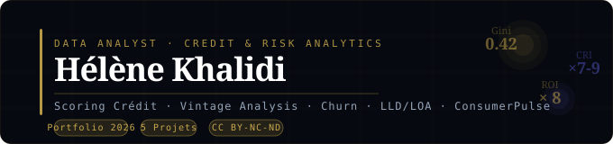

[README_Profil_GitHub.md](https://github.com/user-attachments/files/28595923/README_Profil_GitHub.md)
# Hélène Khalidi
### Data Analyst · Credit & Risk Analytics | FinTech & Banque

---

> *"J'ai géré des milliers de dossiers de financement de A à Z —
> de l'émission de l'offre à la validation scoring.
> Aujourd'hui — je construis les modèles qui automatisent ces décisions."*

---

## 👤 Qui suis-je ?

Conseillère crédit en filiale spécialisée — **analyse et instruction de dossiers de financement** — plus de 15 ans d'expertise terrain — reconvertie **Data Analyst** avec une spécialisation **Credit & Risk Analytics**.

Ce parcours est rare. Il est documenté dans chaque projet de ce portfolio.

**Ce que ça signifie concrètement :**
- Gestion complète du cycle crédit de A à Z → émission offre · contrôle pièces · validation scoring
- Application des critères de scoring au quotidien → je construis maintenant les modèles
- Support aux agences physiques · prêts étudiants · avance rentrée · décotes de taux DA/DGA/DR
- Interface entre politique d'octroi et instruction opérationnelle → vision 360° du financement
- J'ai vu les limites des outils de l'intérieur → je construis ceux que j'aurais voulu avoir

---

## 🗂️ Portfolio — 5 projets Credit & Risk Analytics

| Projet | Concept | Résultat clé |
|---|---|---|
| 🏦 [CreditScore Pro](https://github.com/helene-khalidi/portfolio-risk-credit-analytics/tree/main/Projet1_Scoring-Credit-Bancaire) | Scoring crédit · 3 modèles · Grille décision | Gini 0.42 |
| 📊 [Portfolio Risk](https://github.com/helene-khalidi/portfolio-risk-credit-analytics/tree/main/Projet2_portefeuille) | Vintage 12 cohortes · Early Warning · CODIR | 5 indicateurs EW |
| 🔄 [Churn Bancaire](https://github.com/helene-khalidi/portfolio-risk-credit-analytics/tree/main/Projet3_Shurn-Bancaire) | 4 segments métier · LTV · ROI rétention | ROI × 8 |
| 🚗 [AutoRisk 360](https://github.com/helene-khalidi/portfolio-risk-credit-analytics/tree/main/Projet4_AutoRisk_360) | LLD/LOA · Valeur résiduelle VE · Stress test | Gini résiliation 0.50 |
| 💡 [ConsumerPulse](https://github.com/helene-khalidi/portfolio-risk-credit-analytics/tree/main/Projet5_ConsumerPulse) | Life Events · CRI propriétaire · 6 mois | Discrimination × 7-9 |

🔗 **[→ Voir le portfolio complet](https://github.com/helene-khalidi/portfolio-risk-credit-analytics)**

---

## 💡 Innovations propriétaires

### Consumer Resilience Index (CRI)
Indice propriétaire à 5 dimensions — mesure la capacité d'un client
à absorber un choc financier sans défaillir sur ses engagements.

```
D1 Diversification revenus  (25%)
D2 Épargne de précaution    (30%)
D3 Rigidité charges inversée(20%)
D4 Stabilité historique     (15%)
D5 Filet social             (10%)
```
> Discrimination × 7-9 entre extrêmes vs × 2-3 pour le taux d'endettement seul.

### Life Events transactionnels
Détection de 6 événements de vie via leurs signatures bancaires :
**Perte d'emploi · Séparation · Maladie · Déménagement · Naissance · Retraite**

---

## 🛠️ Stack technique

```python
Langages    : Python 3.11
ML          : Scikit-Learn · Random Forest · GBM · Logistique · K-Means
Viz         : Plotly · Matplotlib · Seaborn
Apps        : Streamlit
Data        : Pandas · NumPy
Notebooks   : Jupyter
```

---

## 📊 Domaines couverts

```
✅ Credit Risk Analytics     Scoring · Gini · KS · AUC · Grille décision
✅ Portfolio Management      Vintage · Early Warning · CODIR · ICAAP
✅ Churn Analytics           Segmentation · LTV · ROI · K-Means
✅ Auto Finance Risk         LLD/LOA · Valeur résiduelle · VE · Stress test
✅ Consumer Intelligence     Life Events · Résilience · Prévention
```

---

## 📫 Contact

[](https://www.linkedin.com/in/helene-khalidi)
[](https://github.com/helene-khalidi)
[](https://creativecommons.org/licenses/by-nc-nd/4.0/)

---

*© 2026 Hélène Khalidi · Data Analyst · Credit & Risk Analytics*
*Tous droits réservés · CC BY-NC-ND 4.0*


